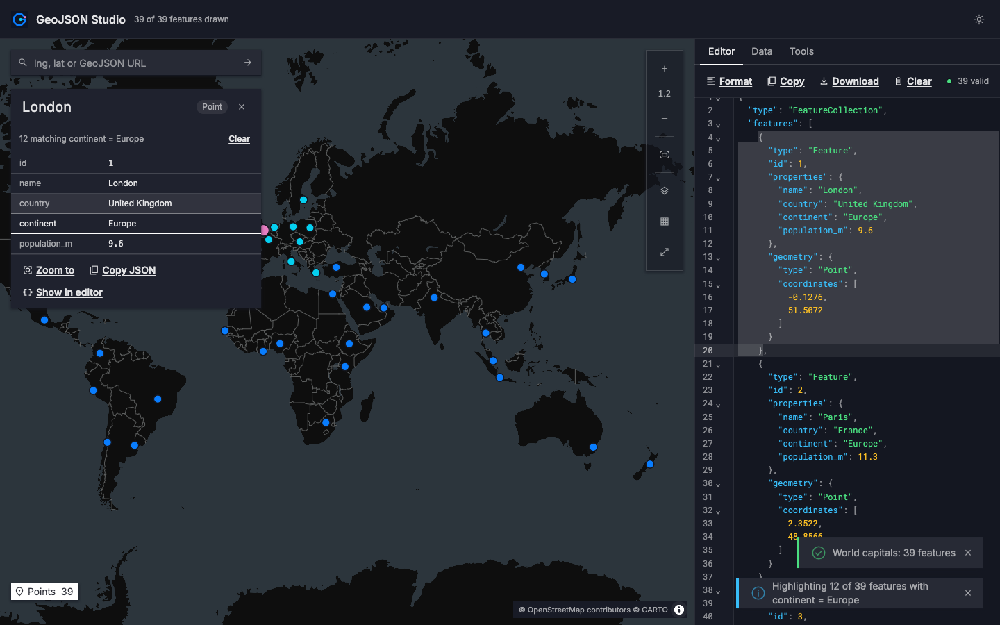
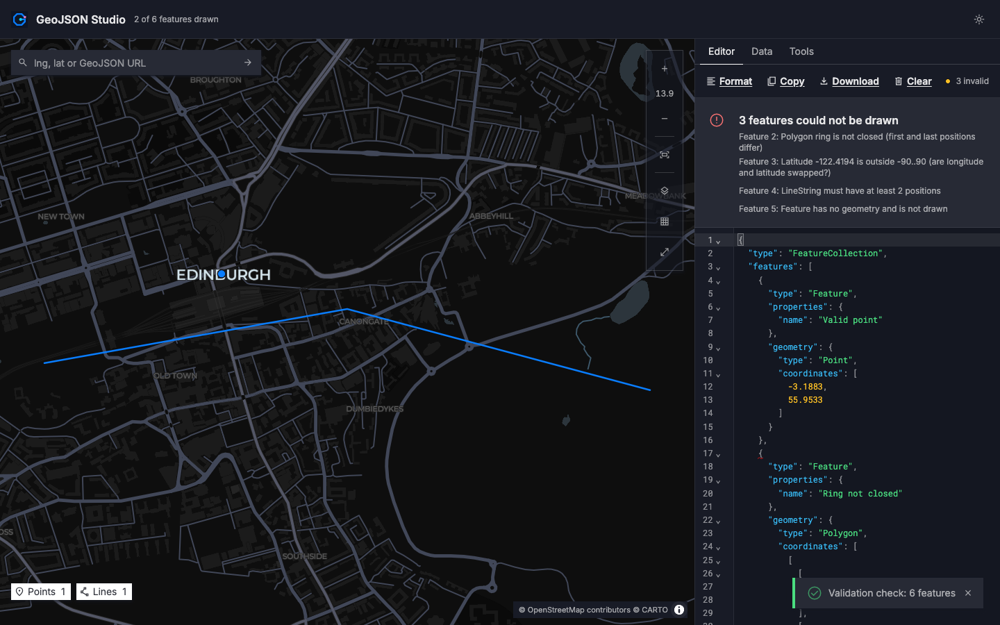
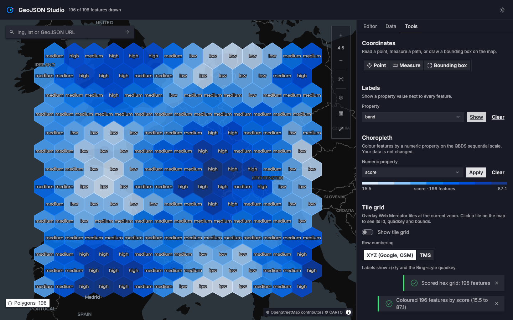
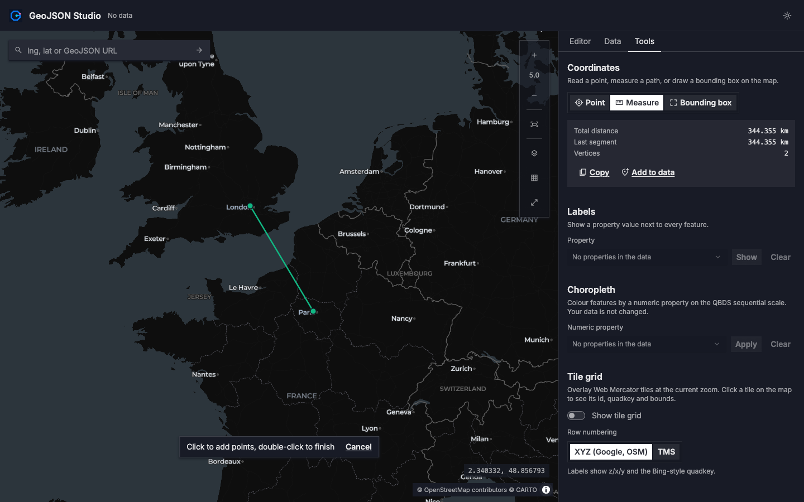
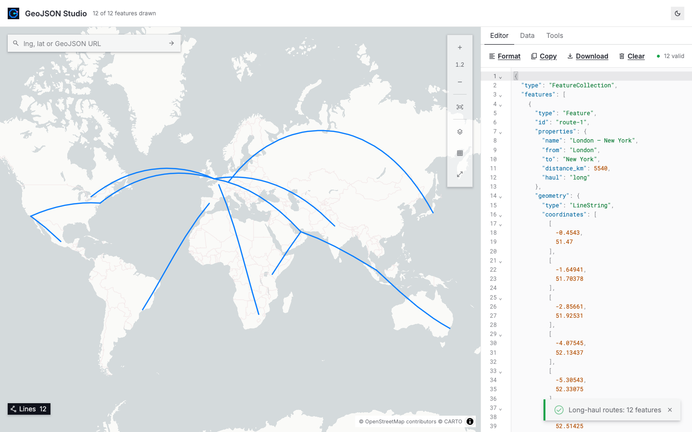

#  GeoJSON Studio

GeoJSON Studio is a browser tool for looking at GeoJSON. Drop in a file, paste some JSON or give it a URL, and your features appear on a map straight away. Once the data is on the map you can:
- click a feature to read its properties
- edit the JSON and watch the map update as you type
- see exactly which features are broken and why
- measure distances
- colour features by a numeric property
- look up web-map tile IDs

It all runs in the browser, so there is no server, no account and no API key.



The app is also a worked example. It was built from an empty folder with the open-source QBDS design system and its `qb-frontend-react` workflow. [How it was built](#how-it-was-built-with-qbds) walks through every step, and the plan the workflow produced is in this repo.

## What you can do with it

| Area | What it does |
| --- | --- |
| **Load** | Drop files anywhere on the page (several files merge into one collection). Drop onto the editor to add to the data you already have. Browse for files, or load from a URL with an optional `Authorization` header. Built-in samples. Deep links: `?url=a;b`, `#url=…`, `?map=lng,lat,zoom`, `?maponly=true`. |
| **Edit** | JSON editor (CodeMirror 6). The map redraws 300 ms after you stop typing. Format, copy, download, and clear with undo. Inputs over 10 MB are shown on the map only. |
| **Validate** | Checks every feature against RFC 7946: positions, ring closure, minimum vertex counts, latitude range (this catches swapped lng/lat), unknown types and null geometries. Problems are marked in the editor gutter and listed above it; click one to jump to it. |
| **Inspect** | Click a feature to highlight it, open its properties and select its JSON in the editor. Moving the editor cursor into a feature highlights it on the map. Selecting a `lng, lat` pair in the editor flies the map there. Clicking a property row highlights every feature with the same value. Points, lines and polygons can each be shown or hidden. |
| **Tools** | Pick a point, measure a path (great-circle distance) or draw a bounding box, then copy the result or add it to the data. Label features by any property. Colour them by a numeric property; this only changes the display and never edits your JSON. A web-map tile grid shows z/x/y, the TMS row and the quadkey, with the tile's bounds on click. |
| **Map** | Zoom readout, fit to data, reset north, basemap menu, map-only mode (Esc to exit), right-drag to rotate and tilt, and a resizable side panel. Dark and light themes. The view, basemap, theme, panel width and your last data (if under 2 MB) are remembered between visits. |
| **Style** | Follows the common simplestyle properties: `fill`, `fill-opacity`, `stroke`, `stroke-width`, `stroke-opacity`, `marker-color`, `marker-size`. |

| | |
| --- | --- |
|  |  |
| Broken features are listed and marked in the editor | Choropleth on the QBDS sequential scale, with labels |
|  |  |
| Measure tool | Light theme |

## Run it locally

You need Node 20 or newer (tested on Node 24).

```sh
git clone https://github.com/jitu5/geojson-studio.git
cd geojson-studio
npm install
npm run dev
```

Then open http://localhost:5173. To try it, click **Open samples** and load **World capitals**, or drag any `.geojson` file onto the page.

| Script | What it does |
| --- | --- |
| `npm run dev` | Start the Vite dev server |
| `npm run build` | Type-check, then build a static site into `dist/` |
| `npm run typecheck` | `tsc -b` |
| `npm run lint` | oxlint |
| `npm test` | Vitest unit tests for the data layer and the map style expressions |
| `npm run test:e2e` | Playwright tests against the production build, in your installed Chrome (no browser download). They also refresh the screenshots in `docs/screenshots/`. |

The build is a plain static site, so `dist/` can be hosted anywhere that serves files.

**HERE basemaps (optional).** The default basemaps are CARTO Dark Matter and Positron, and OpenFreeMap Liberty; none of them needs a key. To add HERE Explore, Satellite and Terrain to the basemap menu, put your own HERE key in `.env.local`, which git ignores:

```sh
VITE_HERE_API_KEY=your-key
```

## How it was built with QBDS

### The building blocks

QBDS is an open-source design system (Apache-2.0) for React and Tailwind. The app uses these parts of it:

| Part | What it is | How this app uses it |
| --- | --- | --- |
| **`@qbds` registry** | A [shadcn](https://ui.shadcn.com) registry. `npx shadcn add @qbds/button` copies the component's source into your project. | 23 components such as button, toolbar, card, table, select and tabs. They live in `src/components/ui/` and are not edited by hand. |
| **Examples** | A JSON file of example compositions for each component, showing how the components are meant to be put together. | Each screen region copies an example: the map toolbar from `ToolbarVertical`, the basemap menu from `DropdownMenuWithRadioGroup`, and so on. |
| **DESIGN.md** | The visual rules: dark first, sharp corners, Material Symbols Sharp icons only, and fixed chart colour palettes. | Dark by default, no rounded buttons, Sharp icons. The chart palettes colour the map data. |
| **TOKENS.md** | Semantic Tailwind v4 classes such as `bg-surface-primary`, `text-fg-secondary` and `border-stroke-divider`. | All UI chrome uses these classes. There is no raw hex in the UI, so the light theme needed no extra work. |
| **`qb-frontend-react` skill** | A four-stage workflow written for AI coding agents. It turns a request into a reviewed JSON plan, then into code. | Followed stage by stage. The full plan is in [`docs/plan/geojson-studio.ui-plan.json`](docs/plan/geojson-studio.ui-plan.json). |
| **`setup-qbds-vite.sh`** | The skill's script for starting a new Vite app with QBDS already wired in. | Created this project. |

### What "greenfield" means here

The skill asks one question before anything else: where does the code go? It offers three answers, which it calls delivery modes:
- **greenfield:** a brand-new app in an empty folder
- **pages:** new screens in an existing app
- **feature:** a change to an existing screen

This app is greenfield. Nothing existed before the scaffold script ran, so everything here, from `package.json` to the end-to-end tests, came out of the workflow.

### Step by step, from an empty folder

**0. Study the reference.** The behaviour comes from [geojson.tools](https://geojson.tools), HERE's open-source GeoJSON Visualizer (MIT). Its source was read to list exactly what it does: how loading, editing, validation and selection work, plus the coordinate tools, labels, heat map, tile grids and deep links. The look, code and map stack here are new; only the behaviour list was carried over.

**1. Requirements.** The plan's `requirements` section records:
- one goal ("drop, paste or link GeoJSON and see it on a map, then inspect, edit, measure and style it")
- three kinds of user
- twelve scope items
- the constraints

The two big decisions were also made here:
- **MapLibre GL JS instead of HERE XYZ Maps.** HERE's SDK needs an API key for any basemap, and MapLibre draws the same GeoJSON with free basemaps. The HERE option is kept: set your own key and HERE basemaps appear.
- **CodeMirror 6 instead of Monaco.** It is much smaller, and its theme can read QBDS CSS variables, so the editor follows the dark and light themes automatically.

**2. UX design.** The goal was split into six user stories. Each one records what the user sees and how it behaves:

| Story | Covers |
| --- | --- |
| Load data | Drop, browse, URL, samples, deep links |
| Edit and validate | Live editor, error list, format, copy, download, clear |
| Inspect features | Click to inspect, property highlights, two-way editor sync, type filters |
| Measure and capture coordinates | Pick point, measure, bounding box, go to `lng, lat` |
| Label and colour by property | Labels, choropleth, legend |
| Navigate and configure the map | Toolbar, basemaps, tile grid, map-only mode, theme |

**3. UI structure.** Before any custom component was allowed, the registry and the examples were checked for every part of the screen. The skill's rule is that **the example wins**: if a design idea conflicts with how a QBDS example composes a component, the example is followed and the change is written down. Five of these changes are recorded in `uxAdjustments`. For instance, the header follows the `SidebarApp` example but leaves out the sidebar, because this is a single-screen tool.

This stage produced:
- **23 `@qbds` installs**
- **5 new components**, each with a written reason why QBDS has nothing that fits:
  - the map
  - the JSON editor
  - the panel resizer
  - the file drop target
  - the choropleth legend

  They are built only from QBDS tokens.

**4. Build.** The scaffold was one command:

```sh
bash setup-qbds-vite.sh geojson-studio @qbds/button @qbds/icon @qbds/icon-shell @qbds/tooltip \
  @qbds/badge @qbds/toolbar @qbds/toggle @qbds/toggle-group @qbds/dropdown-menu @qbds/input \
  @qbds/input-group @qbds/field @qbds/label @qbds/select @qbds/switch @qbds/tag-toggle \
  @qbds/card @qbds/table @qbds/alert @qbds/sonner @qbds/separator @qbds/scroll-area @qbds/tabs
```

The fresh scaffold did not build. Three fixes were needed before any app code; the [test report](docs/qbds-skill-test-report.md) covers them as findings F1 to F3:
- TypeScript 7 has removed `baseUrl`, and the script still writes it.
- One registry item installs a demo file from the QBDS website.
- The CSS imported all three Material Symbols font families, about 13 MB, instead of only Sharp.

After that, the screens were assembled from the plan's `jsx` and `regions`, and the five new components were built.

**5. Verify.** The skill stops at build, so this stage was added. It ran:
- `tsc`
- oxlint
- 54 unit tests
- 11 Playwright tests in a real browser, with screenshots

Two serious bugs only showed up in the browser:
- MapLibre's own CSS overrode a Tailwind class and made the map ignore clicks.
- A MapLibre expression detail (`to-number(null)` is `0`) drew every line 0 px wide.

Both now have tests.

### Where QBDS shows up in the code

- `components.json` holds the shadcn CLI settings the scaffold wrote. To add more `@qbds` components, first add the `@qbds` registry under `registries` in this file.
- `src/styles/globals.css` holds the QBDS tokens; the scaffold installs it.
- `src/components/ui/` holds the registry components, exactly as the CLI wrote them.
- `src/lib/palette.ts` follows the one place DESIGN.md allows raw colours, the chart palettes. Map data is coloured the way a chart would be:
  - qualitative colour 1 for features
  - 7 for the selection
  - 3 for matches
  - 6 for drawings
  - the sequential scale for the choropleth
- `src/features/editor/GeoJsonEditor.tsx` themes CodeMirror from QBDS CSS variables, so switching theme needs no code.
- The logo (`public/logo.svg`) uses the same chart colours as the map. See [The logo](#the-logo).

### The logo


The logo was designed for this app. It is a "G" for GeoJSON, drawn as a single polygon ring that hasn't been closed yet:
- **Blue ring:** the shape being drawn, in the colour the map uses for features.
- **Pink square:** the edit handle where the drawing started, in the selection colour.
- **Cyan dot:** the cursor point, in the colour for matches.

It nods to the app's draw tools and to its "ring is not closed" check. The shapes are sharp, with no rounded corners, to match the QBDS look. The mark sits on a navy square, so the same file works in both themes and as the browser-tab icon.

### What the exercise found

Building a real app is a good test of a design system. [`docs/qbds-skill-test-report.md`](docs/qbds-skill-test-report.md) lists 14 findings. Each one was hit during the build, not found by reading. They include:
- the scaffold problems above
- registry components that break DESIGN.md's own rules
- docs that disagree with each other
- a missing verify stage

## Project layout

```
src/
  state/studio.tsx           app state (data, selection, tools, view), persistence, loading
  lib/geo/                   pure data layer with unit tests
    normalize.ts             parse, normalise and validate GeoJSON
    locate.ts                map between editor text ranges and features; append and merge documents
    render.ts                data shaped for MapLibre (GeometryCollections split, choropleth colours)
    bbox.ts measure.ts tiles.ts draw.ts properties.ts
  lib/palette.ts             QBDS chart palettes used as map colours
  features/map/              MapLibre map, layers, toolbar, search, inspector, overlays
  features/editor/           CodeMirror editor and editor panel
  features/data/             file drop, URL loader, samples
  features/tools/            coordinate tools, labels, choropleth, tile grid
  components/ui/             @qbds registry output (do not edit by hand)
  components/layout/         header, panel resizer, side panel
tests/e2e/                   Playwright tests
docs/plan/                   the workflow's JSON plan
docs/screenshots/            screenshots taken by the e2e tests
```

The map uses one GeoJSON source with `promoteId: '__idx'`. Selection and highlights are set through MapLibre's feature state, so clicking a feature never re-uploads the data.

## Known limits

- Parsing runs on the main thread, so files of tens of MB pause the page while they load. A Web Worker would fix this.
- The JavaScript bundle is about 2 MB (600 KB gzipped), mostly MapLibre and CodeMirror, and is not code-split yet.
- Remote URLs must allow cross-origin requests. This is a browser rule and applies to the reference tool too.
- Lines that cross the antimeridian are drawn as given, without splitting.
- Not carried over from the reference tool: HERE Data Hub spaces (a retired HERE service), HERE-specific `association_ids` highlighting and the HERE tiling scheme.

## Credits

- QBDS design system: components, tokens, design rules and the `qb-frontend-react` workflow (Apache-2.0).
- [geojson.tools](https://geojson.tools), HERE's GeoJSON Visualizer (MIT, © 2019 HERE Europe B.V.), inspired the behaviour. No code, branding or API key from it is used.
- [MapLibre GL JS](https://maplibre.org) for the map, and [CodeMirror](https://codemirror.net) for the editor.
- Basemaps come from [CARTO](https://carto.com/attributions) and [OpenFreeMap](https://openfreemap.org), with map data © [OpenStreetMap](https://www.openstreetmap.org/copyright) contributors.

## Licence

Apache-2.0. See [LICENSE](LICENSE).
